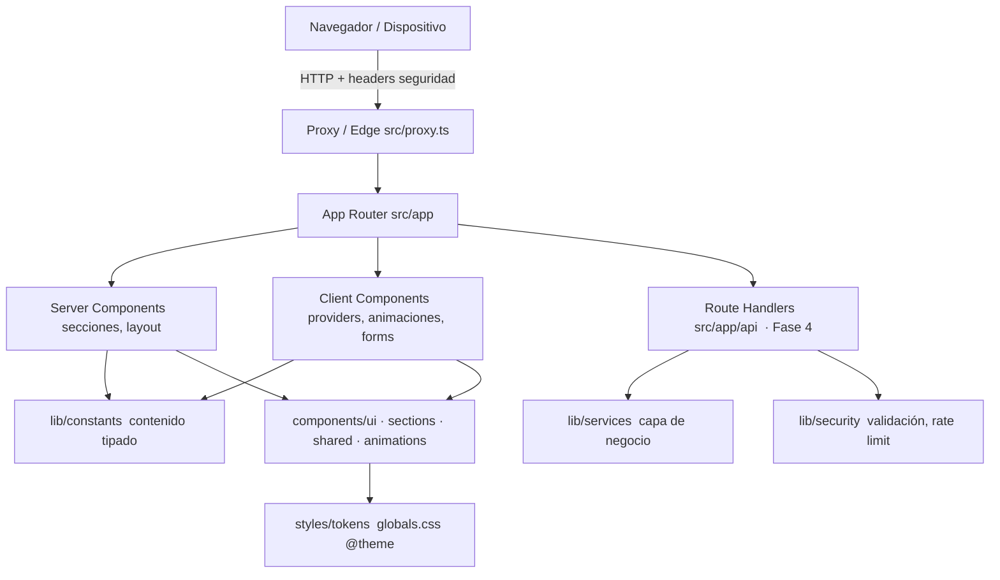

# Arquitectura — Visión general

## En una frase

Aplicación **Next.js 16 (App Router)** renderizada mayormente en el **servidor** (React Server
Components), con una capa de cliente mínima para interactividad (tema, animaciones, formularios),
estilada con **Tailwind v4** mediante **tokens de diseño**, y con **seguridad aplicada por
cabeceras** desde el borde.

## Capas

## Principios de la arquitectura

1. **Server-first:** los componentes son Server Components por defecto; `'use client'` solo
   donde hay interactividad. Menos JS enviado al cliente (§11).
2. **Contenido como datos:** el copy y los datos (servicios, FAQ, testimonios) viven tipados en
   `src/lib/constants`, no incrustados en el JSX. Facilita edición y futura i18n (§8).
3. **Capa de servicios:** la lógica de negocio (envío de contacto, etc.) se abstrae en
   `src/lib/services` para poder cambiar la implementación (mock → email real → BD) sin tocar la UI.
4. **Seguridad transversal:** cabeceras en `next.config.ts` + refuerzo en `src/proxy.ts`;
   validación con Zod en el borde de entrada (`src/lib/security`, `src/config/env.ts`).
5. **Tokens como fuente de verdad visual:** ningún color/tamaño hardcodeado; todo pasa por
   `@theme` en `globals.css` (§6).

## Enrutado (fase actual)

- `/` — landing one-page (secciones ancladas). Rutas dedicadas (`/servicios`, etc.) son una
  decisión pendiente (§19.4) y la estructura ya está preparada con el grupo `(marketing)`.

## Documentos relacionados

- [Estructura de carpetas](./folder-structure.md)
- [Decisiones (ADRs)](./decisions)
- [Sistema de diseño](../02-design-system/colors-and-tokens.md)
- [Seguridad](../05-security/security-overview.md)
